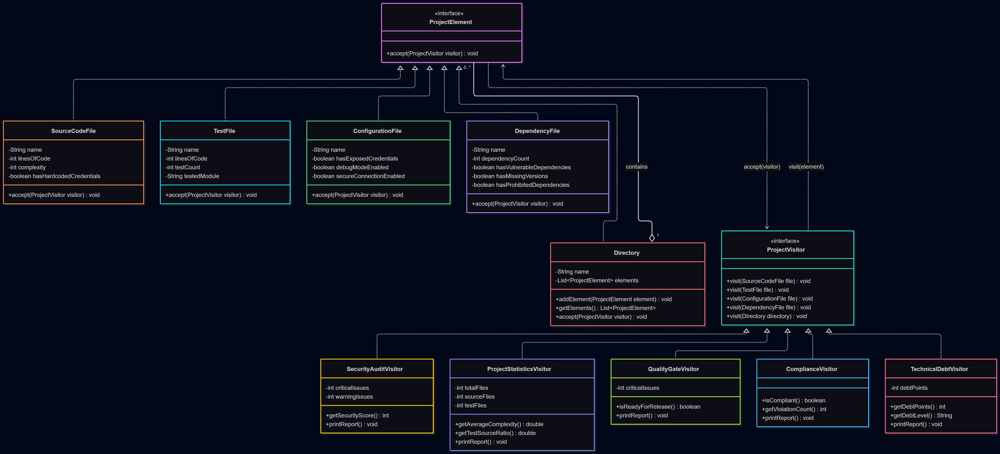
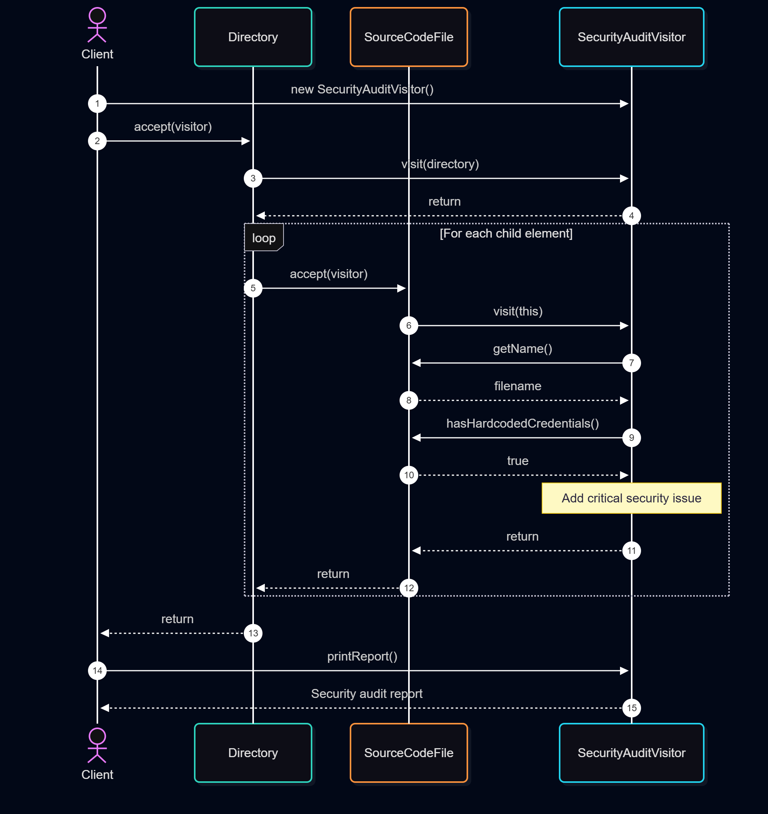

# Assignment 6 — Smart Code Inspection & Compliance Engine

**Design Pattern:** Visitor Pattern  
**Language:** Java 17+  
**Build System:** Maven  
**Testing:** JUnit 5

## 1. Project Overview

This project demonstrates the Visitor Design Pattern by implementing a Smart Code Inspection & Compliance Engine.

The system analyzes a simulated software project containing source code files, test files, configuration files, dependency files, and directories.

Different Visitors perform security audits, collect statistics, check release readiness, verify compliance, and estimate technical debt.

The main goal is to separate project elements from the operations performed on them.

## 2. Project Architecture

### Element Interface

`ProjectElement` defines the `accept(ProjectVisitor visitor)` method.

Five concrete elements implement this interface:

- `SourceCodeFile` — stores source code information, including lines of code, complexity, and security flags.
- `TestFile` — stores test information, including the number of test cases and tested module.
- `ConfigurationFile` — stores configuration security settings.
- `DependencyFile` — stores dependency information and risk flags.
- `Directory` — contains other project elements and supports recursive traversal.

### Visitor Interface

`ProjectVisitor` defines five overloaded `visit()` methods, one for each element type.

Five concrete Visitors implement this interface:

| Visitor | Responsibility |
|---|---|
| SecurityAuditVisitor | Detects security risks and calculates a security score |
| ProjectStatisticsVisitor | Calculates project statistics |
| QualityGateVisitor | Determines whether the project is ready for release |
| ComplianceVisitor | Checks development and business rules |
| TechnicalDebtVisitor | Estimates technical debt using penalty points |

## 3. Visitor Pattern Implementation

Every concrete element implements the `accept()` method:

```java
@Override
public void accept(ProjectVisitor visitor) {
    visitor.visit(this);
}
```

The `Directory` class additionally calls `accept()` on its child elements, allowing Visitors to process nested project structures.

The system does not use `instanceof` or large switch statements to determine element types.

## 4. Quality Gate Criteria

The project passes the Quality Gate only when all three conditions are satisfied:

| Criterion | Requirement |
|---|---|
| Security | Critical security issues = 0 |
| Complexity | Average complexity ≤ 10 |
| Tests | Test/source ratio ≥ 0.40 |

If any criterion fails, the final result is `FAILED`.

## 5. Security Score

The SecurityAuditVisitor calculates a simplified security score:

`Security Score = max(0, 100 - 20 × Critical Issues - 5 × Warnings)`

This is an educational scoring model based on predefined security flags.

## 6. Technical Debt

TechnicalDebtVisitor was added as an additional Visitor without modifying existing ProjectElement classes.

It assigns penalty points for high complexity, large source files, missing tests, enabled debug mode, and missing dependency versions.

The total determines the technical debt level: NONE, LOW, MEDIUM, or HIGH.

## 7. UML Diagrams

### Class Diagram



### Sequence Diagram



## 8. Testing

The project contains 16 JUnit 5 tests covering:

- Different project element types
- Security audit
- Project statistics
- Quality Gate PASS and FAIL
- Compliance violations
- Nested directories
- Empty directories
- TechnicalDebtVisitor
- Boundary values
- Invalid input and edge cases

Run the tests with:

```bash
mvn clean test
```

Expected result:

```text
Tests run: 16, Failures: 0, Errors: 0, Skipped: 0
BUILD SUCCESS
```

## 9. How to Run

Requirements:

- Java 17 or newer
- Maven
- IntelliJ IDEA or another Java IDE

Compile the project:

```bash
mvn compile
```

Run the `org.example.Main` class from IntelliJ IDEA.

The application prints five reports:

1. Security Audit Report
2. Project Statistics Report
3. Quality Gate Report
4. Compliance Report
5. Technical Debt Report

## 10. Assignment Questions and Answers

### Q1. What problem does Visitor solve in your project?

Visitor separates operations from project element classes. It allows the system to perform different inspections without adding inspection methods directly to every element.

### Q2. Where are Element and Visitor?

`ProjectElement` is the Element interface, implemented by five concrete element classes.

`ProjectVisitor` is the Visitor interface, implemented by five concrete Visitor classes.

### Q3. What is double dispatch?

Double dispatch is a mechanism where the executed operation depends on both the concrete element type and the concrete Visitor implementation.

First, the element's `accept()` method is called. Then `accept()` calls `visitor.visit(this)`, selecting the appropriate overloaded `visit()` method.

### Q4. Why not put all operations directly inside the Element classes?

Doing so would mix different responsibilities, such as security, statistics, and compliance, inside the same classes.

Visitor keeps these responsibilities separate and makes new operations easier to add.

### Q5. Is it easier to add a new Visitor or a new Element? Why?

It is easier to add a new Visitor because we only need to create another class implementing `ProjectVisitor`.

Adding a new element requires modifying the `ProjectVisitor` interface and updating all existing concrete Visitors to support the new element type.

### Q6. When would Visitor be a bad choice?

Visitor is less suitable when the element hierarchy changes frequently, because adding a new element requires changes to the Visitor interface and all concrete Visitors.

It works best when the element structure is relatively stable and new operations are added frequently.

### Q7. How is Visitor different from Strategy?

Strategy allows the application to select and switch between interchangeable algorithms.

Visitor allows different operations to be performed on a structure containing multiple element types.

In Assignment 5, Strategy was used to select route optimization algorithms.

In Assignment 6, Visitor is used to inspect different project elements.

### Q8. Which SOLID principles can you identify?

**Single Responsibility Principle (SRP):** Each Visitor has a separate responsibility, such as security auditing or statistics collection.

**Open/Closed Principle (OCP):** New operations can be added by creating new Visitors without modifying existing element classes.

**Dependency Inversion Principle (DIP):** Element classes depend on the `ProjectVisitor` interface rather than specific Visitor implementations.

**Interface Segregation Principle (ISP):** The common Visitor interface defines the operations required by the current element hierarchy, although each Visitor must implement all five methods.

## 11. Visitor Limitation Challenge

### What happens if we add DatabaseMigrationFile?

We would need to:

1. Create a new `DatabaseMigrationFile` class implementing `ProjectElement`.
2. Add `visit(DatabaseMigrationFile file)` to the `ProjectVisitor` interface.
3. Implement the new `visit()` method in every existing concrete Visitor.
4. Update tests and UML diagrams.

This demonstrates the main limitation of Visitor Pattern: adding new operations is easy, but adding new element types requires changes across the Visitor hierarchy.

## 12. Conclusion

This project demonstrates the Visitor Design Pattern using a code inspection system.

It separates project elements from inspection operations, supports recursive directory processing, and allows new Visitors to be added without modifying existing elements.

The implementation includes five element types, five Visitors, 16 JUnit tests, and UML diagrams.